# TP Spring Boot – CQRS et Event Sourcing avec Axon

**Solayman Oumouou**

Dans ce TP, j’ai fait une petite API pour gérer des comptes bancaires. Pour les commandes, Axon enregistre chaque changement du compte sous forme d’événement. Pour les requêtes, je récupère le solde et les opérations dans les tables alimentées par ces événements.

## 1. Premiers essais dans Swagger

J’ai commencé avec la route `POST /commands/accounts/add`. Elle apparaissait déjà dans Swagger.

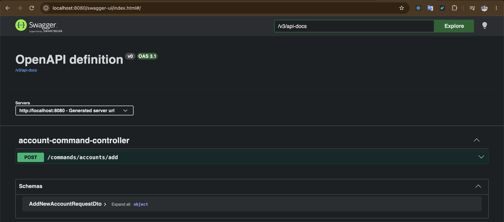

Au premier essai, Swagger affichait `No handler was subscribed for command`. J’ai ensuite ajouté le gestionnaire de la commande dans `AccountAggregate`. À la création d’un compte, l’agrégat enregistre deux événements, un pour la création et un pour l’activation.

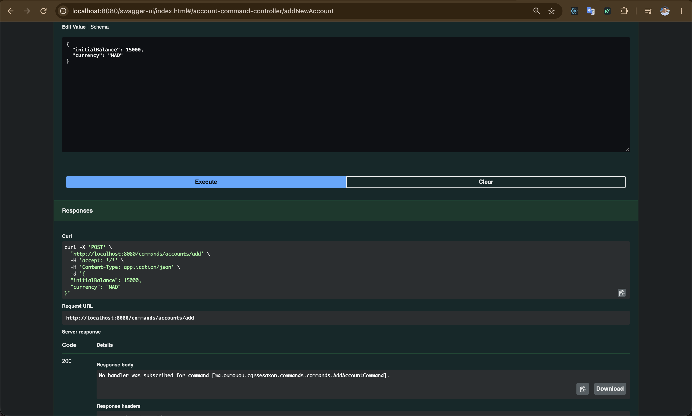

## 2. Lancement avec H2

J’utilise Java 21. Depuis la racine du projet, je lance l’application puis j’ouvre [Swagger](http://localhost:8080/swagger-ui/index.html).

```bash
./mvnw spring-boot:run
```

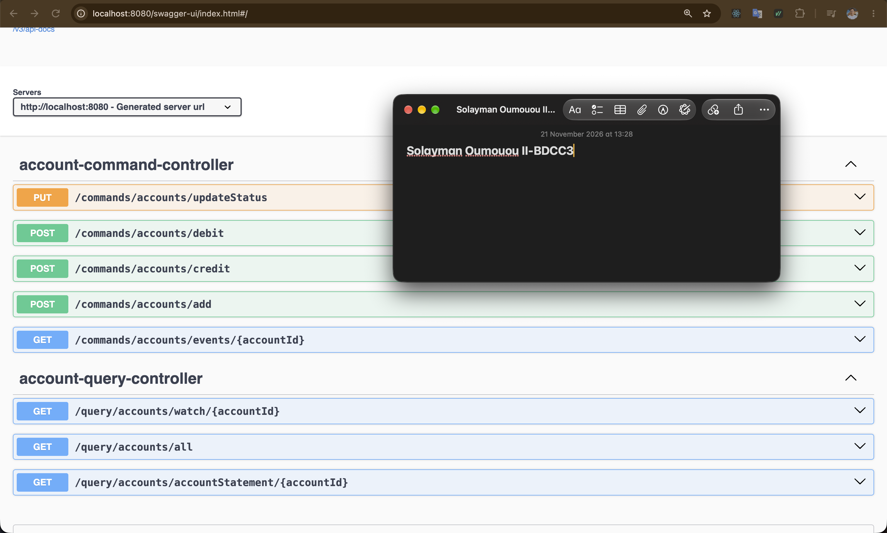

Dans la [console H2](http://localhost:8080/h2-console), je me connecte avec l’URL `jdbc:h2:mem:accounts-db` et l’utilisateur `sa`. Je laisse le mot de passe vide.

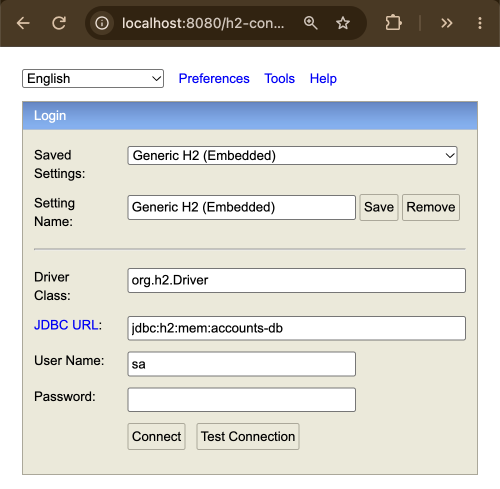

Sur la capture ci-dessous, Hibernate a déjà créé les tables. Au démarrage, `SELECT * FROM ACCOUNT;` ne renvoie encore aucune ligne.

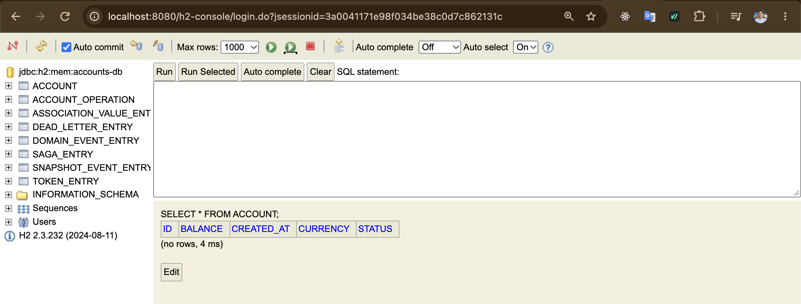

## 3. Test avec un compte

Dans Swagger, j’ai ouvert `POST /commands/accounts/add` et envoyé `{"initialBalance":1000,"currency":"MAD"}`. J’ai gardé l’identifiant renvoyé pour les opérations suivantes.

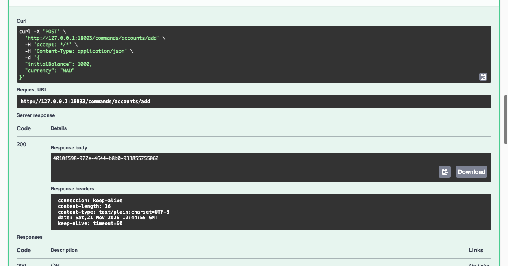

J’ai fait un crédit de **250 MAD** sur `POST /commands/accounts/credit`, puis un débit de **100 MAD** sur `POST /commands/accounts/debit`. Les deux routes prennent `accountId`, `amount` et `currency`.

Pour voir passer les opérations en direct, je lance cette commande dans un deuxième terminal avant le crédit et le débit. Il faut remplacer `ID_DU_COMPTE` par l’identifiant obtenu dans Swagger.

```bash
curl -N "http://localhost:8080/query/accounts/watch/ID_DU_COMPTE"
```

J’ai ensuite essayé de débiter **2 000 MAD**. La commande a renvoyé une erreur **400** pour solde insuffisant.

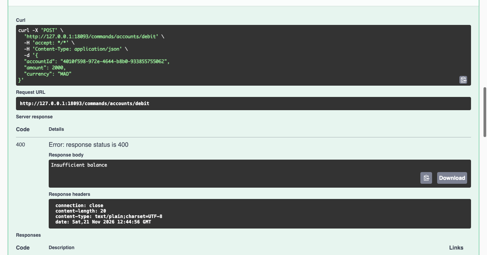

J’ai passé le compte à `SUSPENDED` avec `PUT /commands/accounts/updateStatus` en envoyant `{"accountId":"ID_DU_COMPTE","accountStatus":"SUSPENDED"}`. En ouvrant `GET /commands/accounts/events/{accountId}`, j’ai retrouvé les cinq événements du compte dans l’ordre.

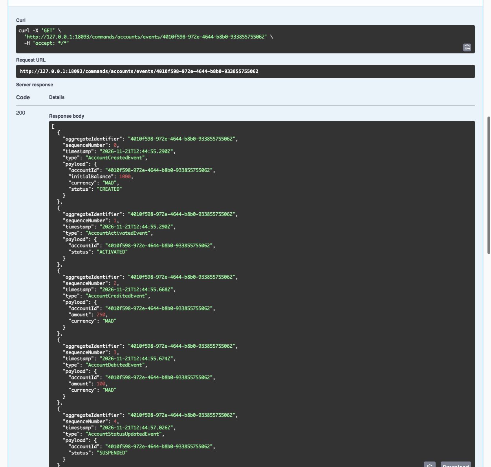

Pour finir, j’ai utilisé `GET /query/accounts/all` pour lister les comptes, puis `GET /query/accounts/accountStatement/{accountId}` pour vérifier le relevé. J’ai obtenu **1 150 MAD** et deux opérations.

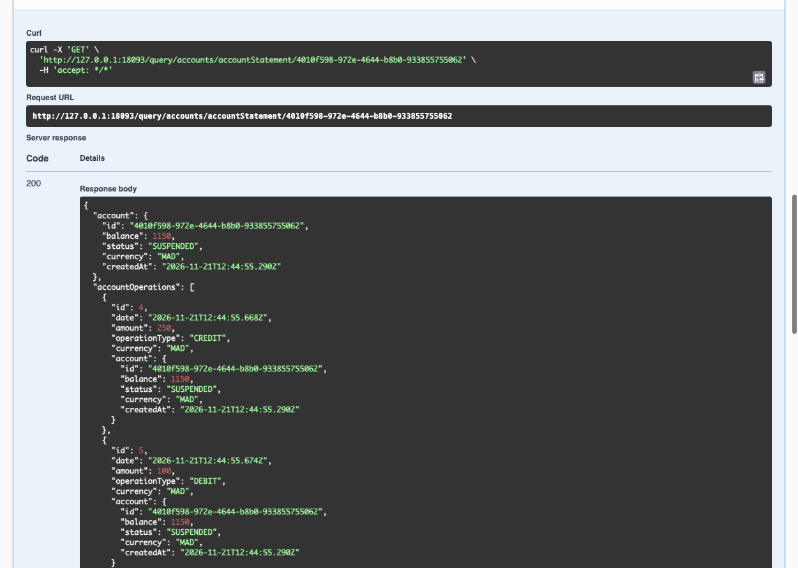

## 4. Essai avec PostgreSQL et Axon Server

Pour cette partie, j’arrête d’abord Spring Boot, puis je démarre les services avec Docker Compose.

```bash
docker compose up -d --wait postgres pgadmin4 axonserver
```

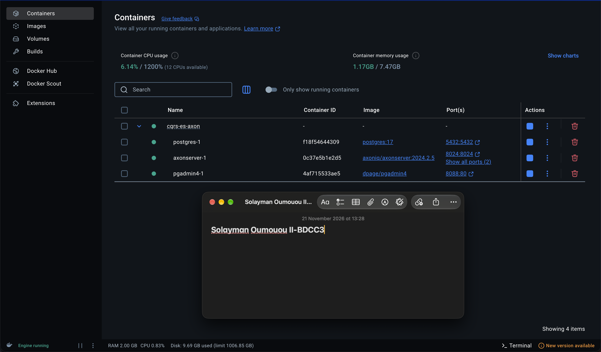

Avec le profil `postgres`, les événements sont enregistrés dans PostgreSQL. Dans [pgAdmin](http://localhost:8088), je me connecte avec `solayman@example.com` et `admin1234`. Pour ajouter le serveur, j’utilise l’hôte `postgres`, le port `5432`, la base `es-accounts` et les identifiants `admin` / `1234`. Après avoir refait le test, je peux consulter les tables `domain_event_entry`, `account` et `account_operation`.

```bash
./mvnw spring-boot:run -Dspring-boot.run.profiles=postgres
```

Pour essayer Axon Server, j’arrête l’application puis je la relance avec le profil `axon`. Dans ce profil, Axon Server stocke les événements, et les tables de lecture restent dans PostgreSQL, sous le schéma `axon_projection`.

```bash
./mvnw spring-boot:run -Dspring-boot.run.profiles=axon
```

J’ai vérifié que `cqrs-es-axon` apparaît sur le [tableau de bord Axon Server](http://localhost:8024).

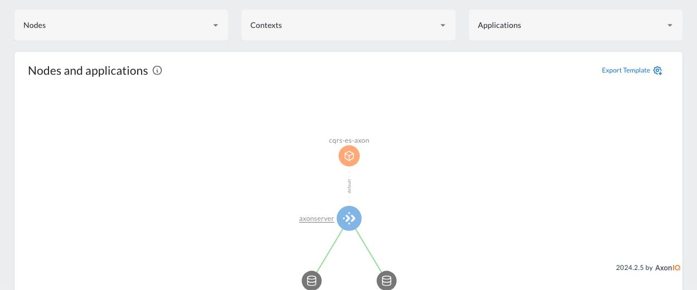
